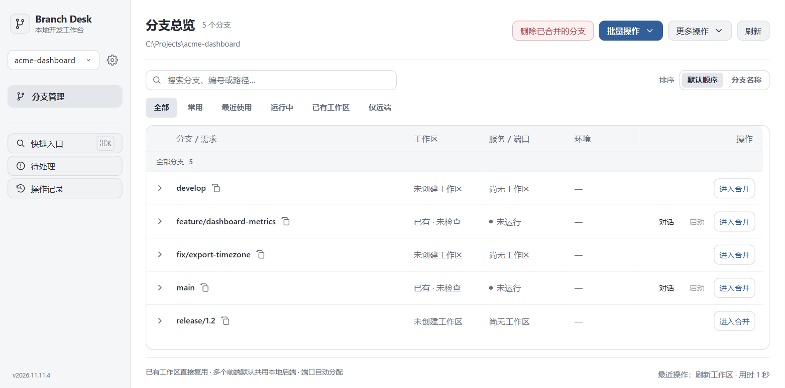
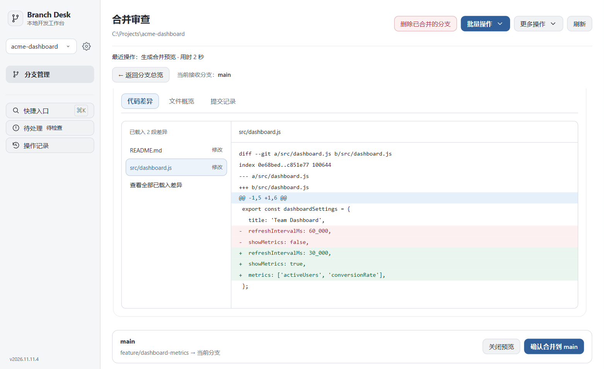

# Branch Desk

本地 Git 开发工作台，在一个窗口中管理多个项目、分支和 worktree，完成差异审查、合并、提交与推送。



## 功能

- **多项目管理**：添加本地 Git 仓库，快速切换项目和工作区。
- **分支与 worktree**：搜索分支、查看同步状态、批量释放工作区或删除已合并的本地分支。
- **可视化合并**：明确来源与接收分支，逐文件查看差异，再确认合并。
- **提交与批量操作**：预览提交和推送，批量合并分支，查看进度与操作记录。
- **开发服务管理**：按需启动受支持的 Vite 前端、Gradle / Spring Boot 后端，查看端口与环境。
- **可选集成**：连接 Codex 辅助处理冲突，关联飞书需求与个人排期。

合并、提交和推送分别确认，不自动推送或强推。

## 安装

### Windows 桌面版

需要 **Windows 10/11 x64**、[Git for Windows](https://gitforwindows.org/) 和 [WebView2 Runtime](https://developer.microsoft.com/en-us/microsoft-edge/webview2/)。

1. 获取维护者提供的 `Branch-Desk-*-Windows-x64-Setup.exe` 并运行。
2. 按提示安装，从桌面或开始菜单打开 **Branch Desk**。
3. 点击“添加项目”，选择已克隆到本机的 Git 仓库，再点击“打开工作台”。

安装包已包含 Python 和 .NET，无需单独安装，默认按当前用户安装。仓库目前暂无 Release 附件，也可按下方方式从源码运行。

### 从源码运行

需要 Python 3.9+、Git 2.38+ 和现代浏览器；Windows 还需安装 `psutil`：

```bash
git clone https://github.com/Morningstar1217/branch-desk.git
cd branch-desk
python -m pip install psutil
python server.py --repo "你的 Git 仓库绝对路径"
```

macOS / Linux 可将 `python` 换为 `python3`。页面资源已随源码提供，无需安装前端依赖。

## 使用

1. 在分支总览中选择目标分支，点击“进入合并”。
2. 选择来源分支，预览并审查差异，再确认合并。
3. 检查结果后提交；需要同步到远端时，单独预览并确认推送。



分支总览右上角的“刷新”获取 origin 的最新引用并重读本地列表。使用“批量操作 → 批量释放 WT”预览和释放多个工作区。启用飞书集成后，可在“待处理事项”批量解除已交付需求的分支关联，也可在清理预览中选择同步解除关联。

“更多操作 → 重启当前工作台”会重启当前项目的后台并自动重新连接。先结束运行中的工作台操作并保存编辑。首次从旧版升级时，请用启动器重新启动后台以加载新接口。

## 常见问题

| 问题 | 处理方式 |
| --- | --- |
| 找不到 Git，或项目无法添加 | 安装 Git for Windows，重启应用，并选择包含 Git 历史的仓库目录。下载的源码 ZIP 本身不是 Git 仓库。 |
| 提示缺少 WebView2 | 安装 WebView2 Runtime 后重新打开应用。 |
| 连接失败或更新后仍是旧界面 | 优先使用“更多操作 → 重启当前工作台”。旧版可关闭后台，再从启动器重新打开。 |
| Codex、飞书或开发服务不可用 | 检查对应工具、登录状态与项目配置；这些集成需要单独配置。 |
| 关闭窗口后后台仍在运行 | 这是正常行为。需要停止时，选择“更多操作 → 关闭空闲工作台后台”；业务服务需单独停止。 |

Windows 配置与日志位于 `%LOCALAPPDATA%\Branch Desk`。仍有问题可[提交 Issue](https://github.com/Morningstar1217/branch-desk/issues)，附上版本、操作步骤与错误信息，分享日志前请移除凭证。

更多说明：[Windows 使用与排障](docs/Windows使用与Codex排障手册.md) · [开发与历史记录](docs/development-notes.md)
